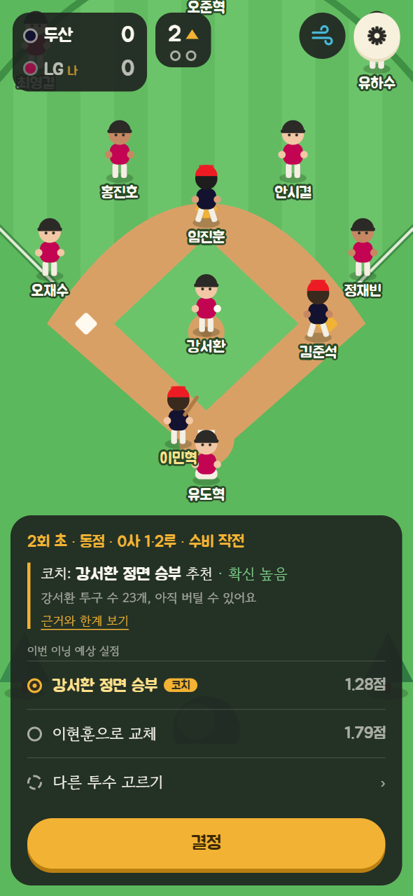
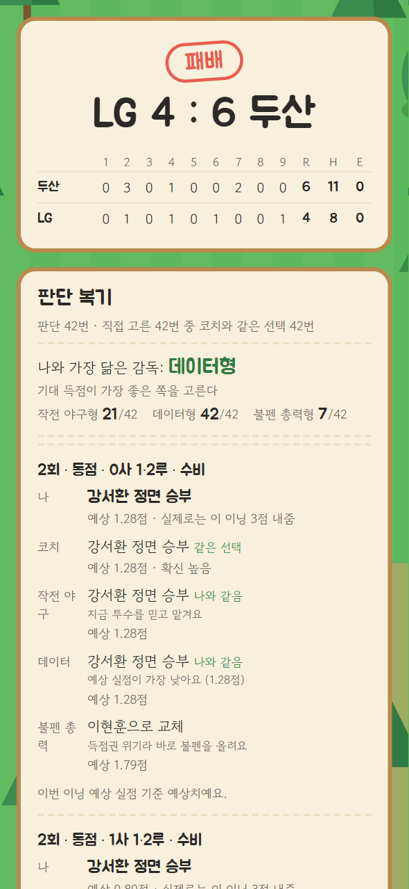

# MY DUGOUT

내가 감독이라면? KBO 구단 하나를 맡아 한 경기를 처음부터 끝까지 운영하는 모바일 야구 감독 게임이다.

라인업을 짜고, 승부처마다 번트·도루·대타·투수 교체를 결정한다. 옆에는 AI 코치가 있지만 사인은 항상 감독이 낸다. 경기가 끝나면 내 판단을 코치, 그리고 철학이 다른 세 AI 감독의 선택과 나란히 놓고 돌아본다.

플레이: https://my-dugout.vercel.app (휴대폰 화면 권장)

> 비공식 팬 게임이다. KBO, 구단, 선수와 관계없고 수익을 내지 않는 개인 프로젝트다.

## 화면

| 시작 | 승부처의 결정 | 복기 |
| :---: | :---: | :---: |
|  |  |  |

<sub>배포된 게임을 가상 선수 기본 로스터로 한 경기 진행하며 캡처한 화면이다.</sub>

## 주요 기능

### 감독석에 앉기
- 구단을 고르면 상대가 정해지고, 홈·원정은 직접 바꿀 수 있다.
- 라인업 화면에서 타순, 후보, 선발 투수를 정한다.
- 경기는 위에서 내려다본 초록 야구장에서 진행된다. 선수를 누르면 시즌 성적과 좌우 상대 기록이 담긴 선수 카드가 열린다.
- 진행 속도(1·2·4배)와 일시정지, 그리고 작전을 물어볼 시점(중요한 순간만 / 매 타석)을 고를 수 있다.

### 승부처의 결정
- 판단 순간이 오면 그 상황에서 가능한 작전만 보여 준다. 주자가 없으면 번트와 도루는 나오지 않는다.
- 작전마다 이번 이닝의 예상 득점(실점)이 붙고, 경기 후반 접전에서는 비교 기준이 "1점 이상 낼 확률"로 바뀐다.
- 원하는 대타나 투수를 직접 고르면 그 선택의 예상치를 다시 계산해 보여 준다.

### AI 코치
- 코치는 추천 작전을 미리 골라 둘 뿐이고, 결정 버튼은 감독이 누른다.
- 추천에는 근거(좌우 상대 타율, 투구 수 등), 한계(적은 표본, 반영하지 못한 요소), 확신 정도가 함께 나온다.
- 공격 작전과 투수·수비를 각각 코치에게 맡길 수 있다. 맡긴 판단도 실행 전 잠깐 대기하며, 그 사이 "잠깐, 내가 고를게요"로 다시 가져올 수 있다.
- 코치를 꺼도 작전별 예상치는 그대로 보인다.

### 경기를 흔드는 변수
- 외야로 부는 바람은 장타를 늘리고, 맞바람은 줄인다.
- 경기 중 갑자기 비가 오면 실책이 늘고 도루·번트가 어려워진다. 폭우가 이어지면 경기가 중단되고, 5회를 넘겼다면 강우 콜드로 끝난다.

### 복기
- 이닝별 점수와 함께, 판단 순간마다 내 선택, 코치 추천, 세 AI 감독의 선택을 예상치와 이유까지 나란히 보여 준다. 세 감독은 번트와 도루로 한 점을 짜내는 작전 야구형, 기대 득점이 가장 높은 쪽을 고르는 데이터형, 위기가 오면 바로 투수를 바꾸는 불펜 총력형이다.
- 내 선택과 가장 많이 겹친 스타일을 "나와 가장 닮은 감독"으로 알려 준다.
- 예상치(시뮬레이션)와 그 이닝에 실제로 일어난 결과를 구분해 보여 준다.

### 내 구단 만들기
- 로스터 편집기에서 선수 이름과 능력치를 직접 입력한다.
- 정확한 숫자 대신 5단계 구간을 고른다. 타자는 타율·홈런·볼넷·삼진·도루·좌투수 상대, 투수는 역할·평균자책점·탈삼진·볼넷·좌타자 상대를 고르고, 고르는 즉시 예상 성적을 미리 보여 준다.
- 파일로 내보내고 불러와서 다른 기기나 친구와 주고받을 수 있다.
- 원하면 AI 초안을 불러와 고칠 수도 있다(아래 참고).

### 기록
- 지금까지 치른 경기를 구단별 카드로 모아 보여 주고, 승패와 코치와 같은 선택을 한 비율 등을 함께 보여 준다.

## AI가 쓰이는 곳

외부 AI API 없이 모두 브라우저 안에서 계산한다.

| 기능 | 방식 |
| --- | --- |
| AI 코치 추천 | 가능한 작전마다 남은 이닝을 500번 몬테카를로 시뮬레이션해 예상 득점·실점을 비교한다. 두 작전의 차이와 시뮬레이션 오차로 확신 정도를 정하고, 근거와 한계 문구를 상황에 맞게 만든다. 이번 이닝만 보면 투수 교체가 늘 유리해 보이므로, 힘이 남은 선발을 내릴 때는 불펜이 떠안을 남은 이닝 부담을 더한다. |
| 상대 팀 운영 | 규칙 기반 자동 감독이 투수 교체, 번트, 도루, 고의사구, 전진 수비를 결정한다. 코치에게 맡긴 영역도 같은 엔진으로 움직인다. |
| AI 감독 스타일 | 코치가 계산해 둔 작전별 예상치를 보고, 세 가지 철학이 각자 다른 작전을 고른다. |
| AI 초안 | 로스터 편집기에서 선택적으로 불러오는 선수 초안이다. 2025 시즌 각 구단 주전급에서 이름을 한두 글자 바꾸고, 능력치는 기록 대신 일반적인 평판으로 매긴 등급이다. 부정확할 수 있어 불러오기 전에 경고하고, 사용자가 고치기 전까지 선수마다 "AI 등급"으로 표시한다. |

## 기술 스택

| 영역 | 사용 |
| --- | --- |
| 프레임워크 | React 19, TypeScript 5.8 |
| 빌드 | Vite 6 |
| 테스트 | Vitest 3 (엔진·코치·로스터 35개) |
| 그래픽 | SVG로 직접 그린 야구장과 선수 캐릭터, CSS 애니메이션(타구, 주자 이동, 비) |
| 스타일 | CSS 변수 기반 순수 CSS, Google Fonts(Jua, Gowun Dodum) |
| 저장 | localStorage(운영 설정, 경기 기록, 직접 만든 로스터) |
| 배포 | Vercel, `main` 브랜치에 푸시하면 자동 배포 |

## 시뮬레이션 엔진

선수의 시즌별 기록은 최근 시즌일수록 크게 가중해 합치고, 표본이 적으면 리그 평균 쪽으로 당긴다. 신인의 10타석 3홈런 같은 기록이 과하게 반영되지 않게 하기 위해서다.

타자와 투수의 확률은 log5(오즈비)로 합치고, 좌우 상대 기록, 투수 피로(투구 수), 날씨, 전진 수비를 반영한다.

타석마다 삼진·볼넷·안타·장타·홈런·땅볼·뜬공을 정하고, 병살, 희생플라이, 주자 속도에 따른 추가 진루, 실책을 처리한다. 9회 말 끝내기, 연장 11회 무승부, 강우 콜드까지 규칙대로 끝난다.

시드 기반 난수를 쓰므로 같은 시드면 같은 경기가 나온다. 테스트에서는 수백 경기를 돌려 팀당 평균 득점이 현실적인 범위인지 확인한다.

사용자가 직접 매긴 능력치는 고른 구간을 예상 시즌 기록 한 줄로 바꿔 같은 엔진에 넣는다. 의도한 값이므로 평균 쪽 보정은 약하게만 적용한다.

## 데이터 원칙

- 기본 선수와 기록은 모두 가상이다.
- KBO 공식 기록은 [KBO 홈페이지 이용약관](https://www.koreabaseball.com/Etc/Policy.aspx) 제14조에서 사전 동의 없는 자동 수집·복제·2차 가공·재배포를 금지하므로, 수집하거나 옮겨 넣지 않는다.
- 실제 선수에 가까운 로스터는 사용자가 편집기로 직접 판단해 만들고, 그 데이터는 사용자의 기기에만 저장된다. 내보낸 로스터 파일은 저장소에 올라가지 않도록 `.gitignore`에서 제외했다.
- 구단 로고와 선수 사진은 쓰지 않고, 구단명과 대표 색만 사용한다.

## 프로젝트 구조

```
src/
  data/       선수·구단 타입, 가상 선수 생성기, 능력치 변환, AI 초안
  engine/     경기 엔진(순수 함수), 기록→확률, AI 코치, 자동 감독, AI 감독 스타일, 날씨, 판단 기록
  storage/    운영 설정, 경기 기록, 직접 만든 로스터
  ui/         야구장, 선수 캐릭터, 선수 카드, 작전 패널, 설정·선수 편집 시트
  screens/    시작, 구단 선택, 라인업, 경기, 결과, 기록, 로스터 편집
```

경기 엔진은 화면과 분리된 순수 함수이므로, UI 없이 테스트에서 경기 전체를 실행할 수 있다. 선수 데이터는 `PlayerRepository` 인터페이스 하나로 들어오므로 데이터 출처를 바꿔도 엔진은 그대로다.

## 실행

```bash
npm install
npm run dev      # 개발 서버
npm test         # 테스트
npm run build    # 배포용 빌드
```
